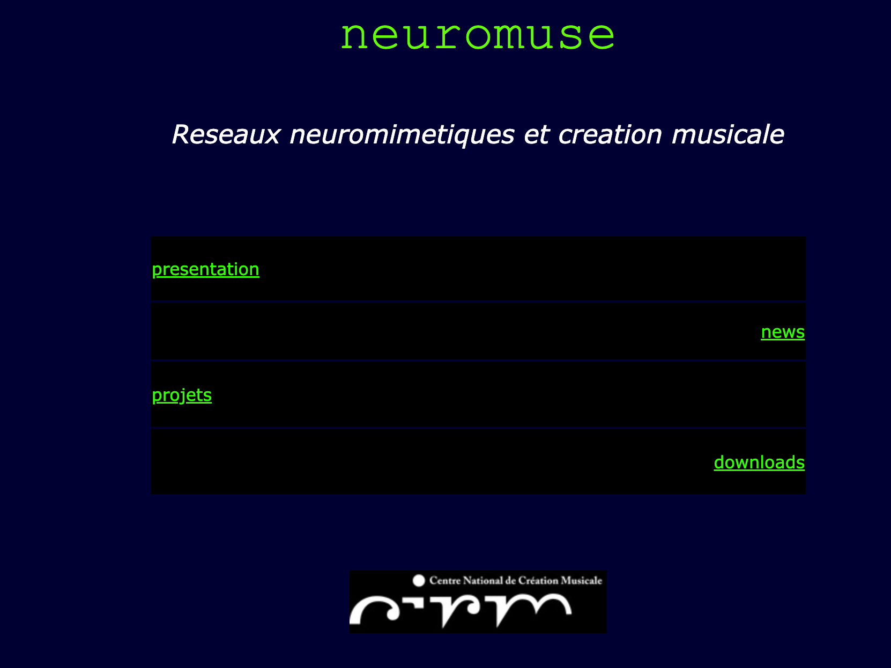

# Philosophie du projet neuromuse

## Présentation (Nice, mai 2005)

### neuromuse — Études et applications musicales des réseaux neuromimétiques

Compositeurs, musiciens, chorégraphes et danseurs recourent de plus en plus à l'informatique dans leurs projets, depuis le travail de création, pour l'exploration des possibles jusque la réalisation, selon différentes modalités de communication homme-machine. L'informatique — la machine universelle — est un outil privilégié de formalisation, d'expérimentation, de simulation et de réalisation.

Cependant, lors de mes différentes expériences comme ethnomusicologue et assistant musical, j'ai pu constater que lorsque la communication avec les machines s'effectue au moyen d'un code écrit dans un langage purement logique, la formalisation nécessaire à l'écriture de ce code peut s'avérer contradictoire avec la nature des connaissances invoquées, lesquelles peuvent être intuitives, inconscientes, implicites, contradictoires, irrationnelles ou magiques. L'informatique traditionnelle est encore peu adaptée à ces situations pourtant courantes, et naturelles, où opèrent des connaissances transitoires et des croyances. L'établissement d'une communication pertinente requiert une adaptation et une plasticité instantanées du programme, si ce n'est un mimétisme que suscite inévitablement le test de Turing. 

Dans ce contexte, les systèmes de réseaux de neurones artificiels, en s'inspirant de processus neurobiologiques, apparaissent comme une alternative particulièrement intéressante dès lors qu'ils situent l'auto-adaptation au cœur même du dispositif informatique.

C'est dans le cadre d'une recherche chorégraphique, en 2000, que j'ai été amené à écrire en langage Lisp mon premier réseau de neurones artificiels. Je constatai alors que si les systèmes neuromimétiques étaient bien capables d'apporter des réponses pertinentes dans les domaines artistiques, la compréhension et la maîtrise de leur fonctionnement constituait un vaste projet.

**Frédéric Voisin, Nice, mai 2005**

   
  Page d'accueil du site <a href="https://euromuse.net">neuromuse.net</a> en 2005, hébergé au CIRM (Nice).

---
*Note de l'auteur : ce qui suit est une version revue et corrigée de la version générée lors d'une discussion avec claude.ia en sept. 2026, [en anglais](PHILOSOPHY.md), laquelle reste à corriger*

## Principes

### 1. L'art est non pas le produit mais le processus
L'apprentissage participe de l'œuvre : il est produit, entendu, vu et suivi en temps réel. Et les erreurs (im)pertinentes.

### 2. La connaissance peut être implicite, intuitive, contradictoire
L'intuition harmonique peut être consciente, en tout cas ressentie, fondée sur l'expérience, voire le contrôle, d'un *temps réel* éventuellement multimodal.
De même le vocabulaire d'un chorégraphe n'est pas seulement articulé, il est incarné.

### 3. L'auto-adaptation au cœur
On crée les conditions d'un comportement qui émerge, à l'échelle de dizaines ou centaines de neurones — ce qui est bien assez pour créer du chaos :
- L'apprentissage se fait en direct, *en interaction* avec l'utilisateur. Une architecture neuromimétique choisie peut s'adapter et évoluer en même temps qu'elle apprend et joue.
- Le système reste interprétable — on peut *comprendre* pourquoi tel choix a été fait ou telle évolution suivie, du fait d'un nombre minimaliste de "paramètres".
- L'échelle est de l'ordre du neurone — les systèmes nécessitent des *dizaines ou centaines* de neurones — seulement, que l'on peut *multi-plier*.
- Le système est (multi-)agentique — décrit dans un language "haut-niveau", *organologique* voire *organique*, Fondé sur la programmation "objet" et le *temps réel*. Chaque neurone, (sous-)réseau ou agent neuromimétique peut être contrôlé individuellement, localement ou à distance.

### 4. Le code participe de l'art
Le code est aussi *écrit pour être lu*. Par exemple, une méthode définie dans le fichier src/mlp.lisp est un petit essai pédagogique sur la rétropropagation, en expressions Lisp simples facilement compréhensibles et modificables par tout un chacun.
Il permet :
- **transparence** : on peut entendre le système apprendre en temps réel, voir ce qu'il « pense » et réagir en conséquence.
- **dialogue** : le système *apprend en même temps qu'il fait* avec l'artiste qui peut l'adapter *au fur et à mesure*.
- **incarnation** : en fonctionnant sur du matériel même modeste (iPhone 5s, Raspberry, etc), le réseau peut habiter un espace physique — un bras robotisé, un ensemble de haut-parleurs... et y *exister*.

---

## Contexte historique

Le projet Neuromuse a été initié entre 1999 et 2001, à une époque où :

- les GPU n'existaient pas encore (CUDA a été lancé en 2006) ;
- les réseaux de neurones étaient scientifiquement intéressants mais semblaient peu praticables pour un travail créatif en temps réel ;
- Lisp restait un environnement sérieux pour la recherche en IA (Ircam, CNMAT, Symbolic Technologies) ;
- la question « un réseau peut-il apprendre une chorégraphie ? » était véritablement inédite.

En 2026, le paysage a changé. "Deep learning" et LLM dominent à force de GPUs. Dans ce contexte, Neuromuse offre un espace où chacun peut **penser avec** des systèmes neuromimétiques, **librement**.

---

## Pour les artistes

Si vous êtes chorégraphe, musicien, plasticien ou designer sonore :

- neuromuse permet de construire des systèmes qui *apprennent de votre pratique* — vos gestes, vos improvisations, vos partitions.
- Vous pouvez entraîner un réseau à interpoler entre deux de vos vocabulaires gestuels, ou à générer des variations sur un thème.
- Le système reste à vous : à comprendre, à modifier. Pas de boîte noire. Pas de cloud propriétaire.

## Pour les chercheurs

Si vous étudiez :

- la *recherche d'information musicale*, la *reconnaissance gestuelle*, l'*IA créative* ou la **ognition incarnée* : neuromuse est un laboratoire pour des expériences à petite ou grande échelle.
- Le code est assez compact pour être compris de bout en bout, et assez complet pour un travail productif en quelques simples lignes de code, facilement générables par une IA-LLM type chatGPT, Claude, Mistral, etc.
- Le code peut facilement être étendu, adapté et utilisé comme outil pédagogique.

---

## Références

- Voisin, F., Meier, R. (2004). « Playing Integrated Music Knowledges with Artificial Neural Networks. » *Journées d'Informatique Musicale*, Ircam/Centre Pompidou, Paris.
- Voisin, F., Meier, R. (2009). « On Analytical vs. Schizophrenic Procedures for Computing Music. » *Contemporary Music Review*, 28(2), pp. 205–219. [DOI](https://doi.org/10.1080/07494460903322489)

