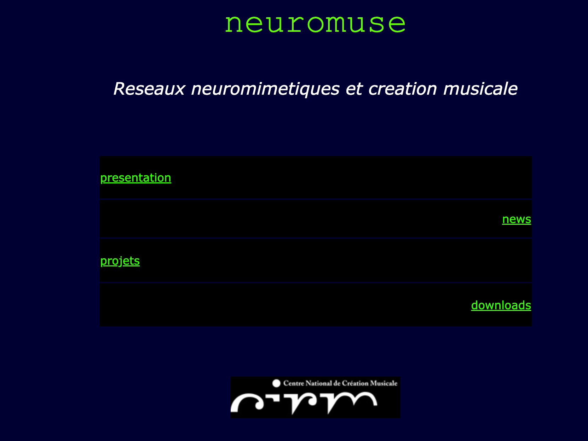

# Philosophy: Why Neuromuse Exists

*[Version française](PHILOSOPHY.fr.md)*

## Presentation (Nice, May 2005)

### neuromuse — Musical Studies and Applications of Artificcal Neural Networks

Composers, musicians, choreographers, and dancers increasingly resort to computing in their projects—from the work of creation, to exploring possibilities, to realization, according to different modes of human-machine communication. Computing—the universal machine—is a privileged tool for formalization, experimentation, simulation, and realization.

However, through my different experiences as an ethnomusicologist and musical assistant, I observed that when communication with machines takes place by means of code written in a purely logical language, the formalization necessary to write that code can prove contradictory to the nature of the knowledge invoked—knowledge that may be intuitive, unconscious, implicit, contradictory, irrational, or magical. Traditional computing remains poorly adapted to these situations—nonetheless common and natural—where transitory knowledge and beliefs operate. Establishing relevant communication requires instantaneous adaptation and plasticity of the program, if not a mimicry inevitably evoked by the Turing test.

In this context, systems of artificial neural networks, drawing inspiration from neurobiological processes, appear as a particularly interesting alternative insofar as they place self-adaptation at the very heart of the computing device.

It was within the framework of choreographic research, in 2000, that I came to write my first artificial neural network in Lisp. I then realized that while neuromimic systems were indeed capable of providing relevant answers in artistic domains, understanding and mastering their functioning constituted a vast project.

**Frédéric Voisin, Nice, May 2005**

   
  Home page of the <a href="https://neuromuse.net">neuromuse.net</a> website in 2005, hosted at CIRM (Nice).

---

*What follows is a revised and corrected version of a discussion with claude.ia about the code, presented in English in Sept. 2026, and translated here from the [French version](PHILOSOPHY.fr.md). It is thus what claude.ia understood from reading the original code and the artistic works it made possible, a synthesis rewritten by the author (Fred Voisin). The original LLM-generated draft is kept as a trace: see [the September 2026 draft](https://github.com/FredVoisin/neuromuse/blob/1c683e76327471f07f7a007218f2d7ca724273b1/doc/PHILOSOPHY.md).*

## Principles

### 1. Art is not the product but the process
Learning is part of the work: it is produced, heard, seen and followed in real time. So are the (im)pertinent errors.

### 2. Knowledge can be implicit, intuitive, contradictory
Harmonic intuition may be conscious, or at least felt, grounded in the experience, even the control, of a possibly multimodal *real time*.
Likewise, a choreographer's vocabulary is not only articulated, it is embodied.

### 3. Self-adaptation at the core
We create the conditions for behaviour to emerge, at the scale of dozens or hundreds of neurons — which is quite enough to create chaos:
- Learning happens live, *in interaction* with the user. A chosen neuromimetic architecture can adapt and evolve while it learns and plays.
- The system remains interpretable — one can *understand* why a given choice was made or a given evolution followed, thanks to a minimal number of "parameters".
- The scale is that of the neuron — the systems only need *dozens or hundreds* of neurons, which can be *multi-plied*.
- The system is (multi-)agentic — described in a "high-level" language, *organological* or even *organic*, based on object-oriented programming and *real time*. Each neuron, (sub-)network or neuromimetic agent can be controlled individually, locally or remotely.

### 4. Code is part of the art
The code, too, is *written to be read*. For example, a method defined in `src/mlp.lisp` is a short teaching essay on backpropagation, written in simple Lisp expressions that anyone can easily understand and modify.
It allows:
- **transparency**: one can hear the system learn in real time, see what it "thinks", and react accordingly.
- **dialogue**: the system *learns while it does*, with the artist, who can adapt it *as it goes*.
- **embodiment**: running on even modest hardware (iPhone 5s, Raspberry Pi, etc.), the network can inhabit a physical space — a robot arm, a speaker array... — and *exist* there.

---

## Historical Context

The Neuromuse project was started between 1999 and 2001, when:

- GPUs didn't exist yet (CUDA launched in 2006);
- neural networks were scientifically interesting but seemed impractical for real-time creative work;
- Lisp was still a serious environment for AI research (Ircam, CNMAT, Symbolic Technologies);
- the question "Can a network learn choreography?" was genuinely novel.

In 2026, the landscape has shifted. Deep learning and LLMs dominate by sheer force of GPUs. In this context, Neuromuse offers a space where anyone can **think with** neuromimetic systems, **freely**.

---

## For Artists

If you're a choreographer, musician, visual artist, or sound designer:

- Neuromuse lets you build systems that *learn from your practice*—your gestures, your improvisations, your scores.
- You can train a network to interpolate between two of your movement vocabularies, or generate variations on a theme.
- The system remains yours to understand and modify. No black box. No proprietary cloud.

## For Researchers

If you're studying:

- *music information retrieval*, *gesture recognition*, *creative AI*, or *embodied cognition*: Neuromuse is a lab for small- or large-scale experiments.
- The codebase is compact enough to understand end-to-end, and complete enough for productive work in a few simple lines of code, easily generated by an LLM such as ChatGPT, Claude, Mistral, etc.
- The code can easily be extended, adapted, and used as a teaching tool.

---

## References

- Voisin, F., Meier, R. (2004). "Playing Integrated Music Knowledges with Artificial Neural Networks." *Journées d'Informatique Musicale*, Ircam/Centre Pompidou, Paris.
- Voisin, F., Meier, R. (2009). "On Analytical vs. Schizophrenic Procedures for Computing Music." *Contemporary Music Review*, 28(2), pp. 205–219. [DOI](https://doi.org/10.1080/07494460903322489)
- Voisin, F. (2015). "De la brousse dans les synthés" [*From the bush in the synths*]. In P. Criton & J.-M. Chouvel (eds.), *Gilles Deleuze: la pensée-musique*. [HAL-01611947](https://hal.science/hal-01611947v1)
