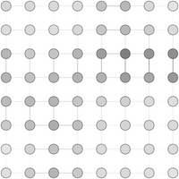

# Output Formats: Saving, Tracing, and Visualizing a Network

Three complementary ways `src/read-write.lisp` writes a network's state to disk — none of them
change anything about training itself, they just read what's already there.

See [EXAMPLES.md](EXAMPLES.md) for the general training workflow, [MLP-exemples.md](MLP-exemples.md)
and [SOM-exemples.md](SOM-exemples.md) for the `xor` and `my-som` networks used as examples below.

## Contents

1. [`save`: reload a network as-is](#1-save-reload-a-network-as-is)
2. [`trace-activation` and `trace-output`: a log over time](#2-trace-activation-and-trace-output-a-log-over-time)
3. [`write-dot`: the network as a graph](#3-write-dot-the-network-as-a-graph)
   - [Coloring edges by weight](#coloring-edges-by-weight)
   - [Rendering to PNG or SVG directly](#rendering-to-png-or-svg-directly)
   - [Demo: `xor`](#demo-xor)
   - [SOM: the grid instead of the connections](#som-the-grid-instead-of-the-connections)
   - [`hopfield` and `auto-assoc`: a grid layout, not a topology](#hopfield-and-auto-assoc-a-grid-layout-not-a-topology)
- [Further Reading](#further-reading)

---

## 1. `save`: reload a network as-is

```lisp
(save xor)              ;; writes xor.lisp in the current directory
(save xor "xor.lisp")   ;; or an explicit path
```

`save` has a method per class with its own idea of what "the state that matters" is — it does **not**
blindly dump every slot for every class:

- **`mlp`/`rmlp`** — every slot, via `structure-slot-names` (SBCL's MOP), so the file created is
  essentially a `(make-instance 'mlp ...)` form with every current value spelled out, net included.
- **`som`** — not every slot: `(net som)` is a list of `neuron` instances and `(neighbourhood som)` is
  a function, neither reads back with `~S`. Instead, `save` writes a single
  `(let ((it (make-instance 'som :size ... :input ...))) ...)` form that re-triggers `init` (so the
  grid comes back correctly wired), then `setf`s the settings that actually matter (`topology`,
  `radius`, `learn-fact`, `temp`, `net-temp`, `distance`, `grid-distance`, `epoch`, `error-scaling`,
  `max-error`) and each neuron's learned weights.
- **`rosom`** — not supported yet (`(net rosom)` is `(content-neurons context-neurons)`, not a flat
  list like `som`'s — `save` errors clearly rather than misreading it).
- **`neuron`** — every slot, same as mlp.

Reload with plain `load`:

```lisp
(load "xor.lisp")   ;; rebinds xor.lisp's :name symbol to the reconstructed instance
```

## 2. `trace-activation` and `trace-output`: a log over time

Both are meant to be dropped into an existing loop without changing anything else about it:

```lisp
(dotimes (i 2000)
  (dolist (pattern *xor-in*)
    (setf (input xor) pattern (goal xor) ...)
    (trace-activation (learn xor) "xor-trace.lisp")))   ;; one line per call, appended
```

`trace-activation` appends one Lisp form per call to `path` (default `activation-trace.lisp`) and
returns its argument unchanged — the same "returns only itself" convention as `learn` across every
architecture, so it drops straight into a chain like the example above. What gets written is
`(activation-state ann)`: `(output ann)` for mlp/rmlp/perceptron, or one activation list per grid cell
for a som (`(mapcar #'output (net ann))` — reads what `find-winner`/`learn` already computed as a side
effect, doesn't recompute anything). Read the whole sequence back, oldest first, with
`(read-activation-trace "xor-trace.lisp")`.

`trace-output` is narrower and `som`-specific: it appends just the winning neuron's current
`activation` (it calls `find-winner` itself, so don't use it from a thread that's also training the
same network, cf. `src/udp.lisp`'s servers — and don't call it on an mlp/perceptron/etc., `find-winner`
has no method for them).

## 3. `write-dot`: the network as a graph

`write-dot` has one method per *shape* of graph, not one per class — what a network's connectivity
means to look at differs enough between an mlp, a som, and a hopfield that one generic rendering
can't serve all of them well. Three shapes exist today:

- **mlp/rmlp/perceptron** — the uniform graph view every `ann` subclass already has, `(nodes ann)`/
  `(edges ann)` (one `edges` method per class, `nodes` derived from it mechanically, see
  `src/neuromuse-main.lisp`): one node per element of `(nodes ann)`, one directed edge
  `source -> target` per element of `(edges ann)`. This is the *input/output* connectivity — which
  weight feeds which unit — which is exactly what defines these architectures.
- **som** — the neighbour structure of the grid instead: a som is defined by *which neurons sit next to
  which*, not by its (very densely bipartite, and not very informative to look at) connections to the
  input.
- **hopfield/auto-assoc** — every cell is already connected to every other cell (there's no "neighbour"
  concept to draw instead, unlike a som), so the useful thing a dedicated method can add is just a
  *readable, fixed layout* — a grid, the same one `src/gui.lisp`'s viewer historically used for these
  (`grid-shape`, not necessarily a perfect square) — rather than whatever a force-directed layout does
  with a fully-connected graph (a "hairball").

`rosom` isn't supported by any of them yet — `(net rosom)` doesn't match what the mlp/perceptron or the
som method assumes, same situation as `save` (`write-dot` errors clearly rather than misreading it).

```lisp
(write-dot xor)   ;; writes xor.dot in the current directory, DOT source only
```

### Coloring edges by weight, and hiding labels

The generic method takes `:color` (nil by default) and `:edge-label` (t by default): color edges by
weight, normalized by the net's largest `|weight|`, instead of, or alongside, the numeric label.
`:node-label` (t by default) controls whether each node shows its own identifier at all:

```lisp
(write-dot xor "xor.png" :format :png :color t)                                  ;; colored AND labeled
(write-dot xor "xor.png" :format :png :color t :edge-label nil)                  ;; colored only, no text
(write-dot xor "xor.png" :format :png :color t :edge-label nil :node-label nil)  ;; color only, nothing else
```

The palette (`diverging-hex`, `src/read-write.lisp`) isn't a plain red/blue fade through white — it's
the one the original (2001-era) MLP visualizer used, on a black background: blue at the most negative
weight, cyan at the median negative, yellow at the median positive, red at the most positive, linearly
interpolated between those four stops (see `img/ecarlate-sin.png`, from *L'Écarlate*, for the look this
is drawn from — `src/gui.lisp`'s own live heatmap uses a separate, simpler white-to-red/white-to-blue
convention, not changed here). Pixel-sampled from that reference image rather than guessed: the bright
green in it is UI text (titles, "INPUT"/"OUTPUT" labels), not an edge color at all — true green is in
fact the rarest hue among the edges themselves, cyan and orange/yellow the most common, so the palette
uses cyan, not green, as its cool median stop (a pale green still appears, but only where the
cyan→yellow interpolation passes near the zero crossing, not as a stop of its own).

The black background itself isn't automatic, though — `write-dot` defaults to white, like any plain DOT
graph. Pass `:dark t` for the black background *and* white node outlines/text (both are needed: left at
their defaults, black outlines and black text would vanish against a black background):

```lisp
(write-dot xor "xor.png" :format :png :color t :dark t)   ;; the img/ecarlate-sin.png look
```

`:edge-label`/`:node-label`/`:dark` are the same three knobs on every `write-dot` method (generic, som,
hopfield/auto-assoc) — just not always with the same default for the first two, since what a node shows
by default differs per shape of graph (see each section below) — `:dark` is nil (white background)
everywhere. `:color` is also accepted by every method, but *not* with the same meaning: this
red/yellow/cyan/blue spectrum by weight sign for the generic method and hopfield/auto-assoc, grayscale
by neighbour distance for a som (see its own section) — each method only reads the keywords
it documents, so passing one a method doesn't recognize (e.g. `:color` to a method that predates this
option) is silently ignored rather than an error: CLOS checks keyword validity against the union of
*all* methods applicable to that `ann`'s class, not just the one actually invoked.

### Rendering to PNG or SVG directly

Pass `:format`, and optionally `:engine` (any Graphviz layout engine — `"dot"`, the default for the
generic method, lays out hierarchically; `"neato"`, `"fdp"`, `"sfdp"` lay out by force; `"circo"`,
`"twopi"` lay out radially). `write-dot` writes the DOT source to a temporary file, renders it with the
external engine (`sb-ext:run-program`, so this needs SBCL and a working Graphviz install —
`apt install graphviz` on Debian), and deletes the temporary file once the render succeeds:

```lisp
(write-dot xor "xor.png" :format :png)    ;; dot -Tpng, hierarchical layout
(write-dot xor "xor.svg" :format :svg)    ;; same, SVG
```

If the engine can't be found or fails, `write-dot` warns and keeps the `.dot` file instead of silently
losing your run — nothing is lost, you can always render it by hand afterward:

```sh
dot -Tpng xor.dot -o xor.png
```

`:format :dot` (the default) never touches an external process at all — the DOT text itself is always
the portable fallback, on any Lisp, with any Graphviz engine, now or later.

### Demo: `xor`

The network built and trained in [MLP-exemples.md](MLP-exemples.md):

```lisp
(make-mlp xor 2 1 2)
(setf (learn-fact xor) 0.4 (threshold xor) 0.1)
;; ... train as in MLP-exemples.md ...
(write-dot xor "xor.png" :format :png)
```

Three input/hidden/output layers, nodes named `(layer index)` (layer 0 = input), one edge per synapse:
*(Two input nodes `(0 0)` `(0 1)` feeding two hidden nodes `(1 0)` `(1 1)`, feeding one output node
`(2 0)` — six weighted edges in total, `dot`'s hierarchical layout puts the layers in order
top-to-bottom.)*

### SOM: the grid instead of the connections

A som's `write-dot` method takes `:mode` and `:component` in addition to `:color`/`:edge-label`/
`:node-label`, plus `:labels` and `:scale` — and defaults `:engine` to `"neato"` instead of `"dot"` —
a different method, not the generic one with different defaults. It draws `(grid-neighbour-pairs ann)`
(`src/som.lisp`: unique pairs of neurons that are actual grid neighbours — 4-connected for a `:square`
lattice, 6-connected for `:hex`, whichever `(topology my-som)` says — not the input connections `edges`
would give) at **fixed positions** (`pos="x,y!"`, which `neato` honors directly — hence the engine
default) instead of letting the engine lay them out:

```lisp
(make-instance 'som :name 'my-som :size 144 :input 18)
;; ... train as in SOM-exemples.md ...
(write-dot my-som "map.png" :format :png)                       ;; U-matrix (default mode)
(write-dot my-som "plane-3.png" :format :png :mode :component :component 3)  ;; one of 18 planes
```



*(An 8×8 som, 5 inputs, after 200 training steps, `:mode :u-matrix` — the default — rendered with
`neato`. The darker band is a cluster boundary: neighbours there have more dissimilar weight vectors
than elsewhere on the map.)*

**What an edge means here is not what it means for an mlp.** A som has no neuron-to-neuron connection
to show in the first place — each neuron's only weights point at the *input* (`(weights neuron)`), never
at another neuron, so unlike the generic method's edges, these aren't synaptic weights at all:

- **That the edge exists** encodes grid *topology*, not a weight: it means these two neurons are
  immediate neighbours on the map (per `(topology my-som)`'s lattice), a purely spatial/structural fact
  fixed at construction, independent of what the som has learned.
- **What the edge is colored/labeled with** (`:mode :u-matrix`, the default) is a *derived* quantity —
  the Euclidean distance between the two neighbours' weight vectors, `(euclidian (weights n1)
  (weights n2))` — not a weight read directly off the net. Similar weights (small distance) between
  neighbours means they're part of the same cluster on the map; dissimilar weights (large distance)
  mark a cluster boundary — classic U-matrix reading. `:mode :component` doesn't color edges at all by
  default (only nodes carry information in that mode); `:edge-label t` can still print that same
  distance as text regardless of mode or `:color`.

**`:mode :u-matrix`** (the default) colors each edge grayscale by that distance (see above), and each
node by its *average* distance to its grid neighbours, same scale — the classic U-matrix picture. This
coloring is what `:color` (t by default — this is the one method where it defaults on, since it's the
whole point of the default mode) turns off, for a plain black-and-white topology diagram instead:

```lisp
(write-dot my-som "map.png" :format :png)                  ;; U-matrix, colored (the default)
(write-dot my-som "map.png" :format :png :color nil)       ;; same topology, no coloring at all
```

`:edge-label` (nil by default, unlike the generic method) prints the actual distance on each edge as
text — works in either mode, independent of `:color`:

```lisp
(write-dot my-som "map.png" :format :png :edge-label t)
```

**`:mode :component`** needs `:component <k>`, the index of one input dimension (0 to `(1- (in-size
my-som))`): colors each node, white to blue, by that one weight component — one of `(in-size my-som)`
"component planes," showing how a single input dimension is distributed across the map (`:color` has no
effect in this mode — a component plane *is* its coloring). Call once per dimension
(`(dotimes (k (in-size my-som)) (write-dot my-som (format nil "plane-~D.png" k) :format :png
:mode :component :component k))` for all of them at once) — edges stay drawn, undecorated unless
`:edge-label t`.

**`:labels`** (nil by default) annotates each node with a value you supply — a sequence as long as
`(net my-som)`, in that order. Nothing in `som.lisp` keeps a history of which neuron won how often (same
reason the live viewer in `src/gui.lisp` accumulates its own `winner-history` rather than reading one
off the network), so a best-matching-unit count has to be tallied by the caller first, e.g. with
`inventaire-h` (`src/maths.lisp`) over a logged sequence of winners, then passed in. Without `:labels`,
`:node-label` (nil by default) falls back to showing each node's own index instead:

```lisp
(write-dot my-som "map.png" :format :png :labels (mapcar #'second (inventaire-h winner-log)))
(write-dot my-som "map.png" :format :png :node-label t)   ;; no :labels: shows 0, 1, 2... instead
```

A `:boundary :torus` map's wraparound edges (first and last neuron of a row/column) still get drawn —
`grid-neighbour-pairs` computes the topology correctly either way — but on this flat layout they end up
collinear with, and so visually indistinguishable from, the ordinary edges along that same row/column:
the topology is right, the picture just doesn't make the wraparound obvious.

### `hopfield` and `auto-assoc`: a grid layout, not a topology

Same `:color`/`:edge-label` as the generic method (see above — `:node-label` here defaults to nil, same
as a som, rather than showing anything by default), plus `:scale` (as for a som) and `:threshold` — the
one thing worth adding here, since unlike a som's grid neighbours, a hopfield/auto-assoc cell connects
to *every* other cell: on anything but a small network, drawing all of them gets dense fast (180 cells,
as in the `ecarl180` network in `doc/auto-assoc-exemples.md`, is 180×179/2 = 16110 pairs). `:threshold`
(0 by default, i.e. draw everything) skips any edge whose `|weight|` falls below it:

```lisp
(make-hopfield hop 12)
(setf (input hop) '(1 0 1 0 1 1 0 0 1 0 1 0))
(learn hop)
(write-dot hop "hop.png" :format :png :color t)                  ;; every pair, colored by sign
(write-dot hop "hop.png" :format :png :color t :threshold 0.1)   ;; only the stronger connections
```

Node color reflects `(output ann)` *if it's already there* — white to blue, normalized by its own
min/max — showing whatever pattern the network currently holds: `nil` until `run-hopfield`/
`run-auto-assoc` actually writes it (`learn` never does, cf. [MLP-exemples.md](MLP-exemples.md) and
`src/hopfield.lisp`/`src/auto-assoc.lisp`'s own docstrings), a neutral gray in the meantime:

```lisp
(run-hopfield hop)                                  ;; writes (output hop)
(write-dot hop "hop.png" :format :png :color t)      ;; now the nodes show the recalled pattern too
```

---

## Further Reading

- [EXAMPLES.md](EXAMPLES.md) — general training workflow.
- [MLP-exemples.md](MLP-exemples.md), [SOM-exemples.md](SOM-exemples.md) — the `xor`/`my-som` networks
  used above.
- `src/neuromuse-main.lisp` — `nodes`/`edges`, the generic graph view the mlp/rmlp/perceptron
  `write-dot` method reads.
- `src/som.lisp` — `grid-neighbour-pairs`, the grid topology the som `write-dot` method reads.
- `src/maths.lisp` — `grid-shape`, the cell layout the hopfield/auto-assoc `write-dot` method reads.
- `src/read-write.lisp` — `save`, `write-dot` (one method per class of graph shape),
  `trace-activation`/`trace-output`, full docstrings.
